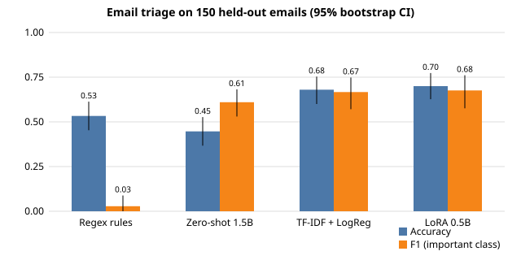

# Model Lab

[](https://github.com/aidankaras/model-lab/actions/workflows/ci.yml)
[](LICENSE)
[](pyproject.toml)

Small, cheap, honest evaluations of which model is worth its price for a given job, run on real workloads instead of leaderboards.

**TL;DR**
- On a real email-triage task, a LoRA-tuned 0.5B model reached **70% accuracy** (95% CI 63-77%) against **53%** for the production regex rules. But a TF-IDF + logistic regression baseline that trains in 1.5 seconds got **68%**, and the difference between the two is not statistically significant (McNemar p = 0.70). With 263 training emails, the classic baseline is the better engineering choice: roughly two orders of magnitude faster per email (median 92 ms vs about 1 ms) and no deep-learning dependencies.
- Across the model-comparison experiments, the ranking of models often depended on **which grader** scored them. Single-grader "A beats B" claims are treated as indicative only.
- Paying for higher reasoning effort bought no clear quality gain on these tasks. The cheapest model (glm-5.3-flash) had the lowest cost per passed task under a single grader and under a majority of three graders, but the quality ranking of the other two models flips between those two grading schemes.



## Problem

Benchmarks measure the wrong thing for a personal assistant stack: a model can top a leaderboard and still be verbose enough to double output cost, weak at tool use, or prone to confident falsehoods. The question here is narrower: **which model gives the best value for each job, measured on tasks like the ones actually run?**

## Method

- **Cost per passed task.** Each task is pass/fail; the headline number is candidate spend divided by tasks passed. Zero passes means the number is undefined, not zero. The model-comparison experiments ran in a separate harness that is not in this repo. `python -m modellab.rollup` recomputes the reported numbers from the committed result files, using the helpers in `modellab/scoring.py`.
- **Cross-family graders.** The rule is that the grader is never the candidate and never from the candidate's family (`grader_conflicts` / `assert_grader_separate`). It was broken in three places, and those cells are marked as contaminated in the result files: E02 (gemini-3.7-flash graded its own answers), and the deepseek cells of `grader-robustness.json` and of the majority column in `e08b-three-graders.json` (deepseek-v4-pro graded deepseek answers). `modellab.rollup` lists the last two.
- **Fabrication = automatic fail.** A task passes only if the grader passes it and there are zero fabricated claims.
- **Grader robustness.** After finding that rankings moved with the grader, the bar became a majority of three graders from different model families. The effort-ladder numbers below are reported both ways.
- **Uncertainty is reported.** Email-triage metrics carry 95% percentile bootstrap intervals (2000 resamples over emails), and paired comparisons use an exact McNemar test (`email_triage/metrics.py`).
- Costs in the result files were recorded after each run. Recorded spend across `results/` is about $0.61; some grading passes have no recorded cost.

## Email triage: classic baseline vs small LLMs vs rules

Binary "needs attention / skip" on 150 held-out real emails, hand-labeled by the author (71 important / 79 not). The split is by time: systems train on the 263 older emails and are tested on the 150 newest. Data is not released for privacy. Everything ran on a CPU laptop, $0 in API spend.

| System | Acc (95% CI) | Precision | Recall | F1 (95% CI) | p50 / p95 latency | Train time |
|---|---|---|---|---|---|---|
| Production regex rules¹ | .533 (.453-.613) | 1.000 | .014 | .028 (.000-.088) | n/a | n/a |
| Zero-shot Qwen2.5-1.5B-Instruct² | .447 (.367-.527) | .458 | .915 | .610 (.530-.682) | 1561 / 2076 ms | none |
| TF-IDF + logistic regression | .680 (.600-.753) | .658 | .676 | .667 (.571-.748) | 1 / 7 ms³ | 1.5 s |
| LoRA-tuned Qwen2.5-0.5B | .700 (.627-.773) | .691 | .662 | .676 (.576-.761) | 92 / 138 ms | 283 s |

Paired McNemar tests against the LoRA model: rules p = 0.003, zero-shot p < 0.001, TF-IDF p = 0.70.

¹ The `prod` column holds the stored decisions of the author's existing regex mail filter. Those rules are part of a private mail setup and are not in this repo, so this row cannot be inspected or re-run here.
² Recorded with an earlier scoring method that compared only the first sub-token of "IMPORTANT" and "SKIP" at threshold 0. The script now scores the full label words and also reports a train-calibrated threshold; this row needs a re-run.
³ Latency was recorded in whole milliseconds, so the TF-IDF median is only known to be about 1 ms. Zero-shot timing in that run excluded tokenization while the other systems included it.

What this says:
- The rules catch 1 of 71 important emails. As a filter they are close to useless.
- The zero-shot model gets high recall only by calling nearly everything important (77 false positives, 2 true negatives), so its accuracy falls below the 52.7% majority-class rate.
- The test finds no detectable difference between LoRA and TF-IDF at n = 150 (p = 0.70). That is not proof they are equal, but the fine-tune shows no measurable gain for its cost at this data size; more labeled data looks like the lever, not a bigger model.
- The numbers above were produced by these scripts (`email_triage/baseline.py`, `email_triage/triage_binary.py`, `email_triage/make_results.py`) on the private data. Library versions for that run were not recorded. `requirements-train.txt` now pins a stack that installs together, and new runs write the installed versions into each predictions file. Since that run, the zero-shot scoring, the latency timing span and the p95 rule (now nearest rank) have changed; the LoRA, TF-IDF and rules accuracy numbers are not affected by those changes. Source: [`results/email-triage/lora-triage.json`](results/email-triage/lora-triage.json).

## Model-comparison experiments

| Experiment | Finding | Source |
|---|---|---|
| Reasoning effort ladder (108 runs: 6 tasks x 3 effort levels x 2 runs x 3 models) | No effort level buys a clear quality win. Graded by gpt-6-luna alone: kimi-k2.6 17/36 passed ($0.0129 per pass), deepseek-v4.1-flash 14/36 ($0.0015), glm-5.3-flash 17/36 ($0.0009, 0 fabrications). Majority of three graders: kimi 29/36 ($0.0075), deepseek 16/36 ($0.0013, contaminated), glm 17/36 ($0.0009). | [`e08b-effort-ladder.json`](results/e08b-effort-ladder.json), [`e08b-three-graders.json`](results/e08b-three-graders.json) |
| Grader robustness (5 graders, same answers) | On the three graders that scored every cell, spread was 5-7 of 12 points for kimi, 6-7 for deepseek and 2-4 for glm. With all five graders (kimi and deepseek only) it reached 6-9. kimi's apparent lead exists only under the lenient graders. | [`grader-robustness.json`](results/grader-robustness.json) |
| Router test A: goal to worker role (12 goals, 3 models) | gpt-6-luna 12/12, glm-5.3-flash 12/12, deepseek-v4-flash 11/12. One rater, one batch each. | [`e06a-goal-routing.json`](results/e06a-goal-routing.json) |
| Router test B: route decision (20 hand-labeled scenarios, 2 models, 2 runs each) | A harder test with a different conclusion: mean accuracy gpt-6-luna 0.675, deepseek-v4-flash 0.650. 19 of the 27 misses fall on the same five items with ambiguous labels, so label quality, not the model, limits the score. | [`e06b-scenario-routing.json`](results/e06b-scenario-routing.json) |
| Session-mined benchmark (10 tasks, no tools) | glm 10/10, deepseek 10/10, kimi 7/10 (three fabricated-adjacent answers). Tests honesty, not capability. | [`e01b-session-benchmark.json`](results/e01b-session-benchmark.json) |
| Prompt caching, long sessions | Caching works on glm-5.3-flash but saves only 21-35% of input cost because input is already cheap; cached vs fresh input price ratio is 1.56x on glm vs 6.7x on deepseek. | [`e07-prompt-cache.json`](results/e07-prompt-cache.json) |
| Bot-wall browsing test | Negative: neither tool got past a Cloudflare-protected page with defaults. | [`t02-bot-wall.json`](results/t02-bot-wall.json) |

Every result file is described in [`results/README.md`](results/README.md), including what the model names refer to.

## How to reproduce

```bash
python -m venv .venv && . .venv/bin/activate
pip install -r requirements-dev.txt
python -m pytest -q          # offline, no network, no model downloads
ruff check .
pre-commit run --all-files
python -m modellab.rollup    # recompute the model-comparison numbers from results/
```

Demo on the synthetic fixture (20 fake emails, all `example.com` / `acme.com`):

```bash
python -m email_triage.make_results tests/fixtures/emails_synth.jsonl /tmp/none /tmp/out.json
python -m email_triage.chart results/email-triage/lora-triage.json /tmp/chart.svg
```

To run the email study on your own mailbox, you need a JSONL in the fixture schema (`tid,name,from,subject,snippet,date,labels,split,gold,prod`) plus a `tid<TAB>0|1` label file for the train rows. `pull.py` and `prepare.py` get you the JSONL from Gmail:

```bash
pip install -r requirements-pull.txt
GMAIL_TOKEN=token.json python -m email_triage.pull RAW.jsonl 1500
python -m email_triage.prepare RAW.jsonl DATA.jsonl --test-n 150 --prod-label "YOUR_FILTER_LABEL"
# hand-label the emails listed in DATA.test-tids.txt as GOLD.tsv (tid<TAB>0|1), then:
python -m email_triage.prepare RAW.jsonl DATA.jsonl --test-n 150 --prod-label "YOUR_FILTER_LABEL" --gold GOLD.tsv
```

`prepare.py` splits by time (the newest `--test-n` emails are the test set) and sets `prod` from a label your existing filter applies. Then:

```bash
pip install -r requirements-train.txt
python -m email_triage.baseline DATA.jsonl LABELS.tsv OUT_DIR
python -m email_triage.triage_binary lora DATA.jsonl LABELS.tsv OUT_DIR
python -m email_triage.triage_binary zeroshot DATA.jsonl LABELS.tsv OUT_DIR
python -m email_triage.make_results DATA.jsonl OUT_DIR results.json
```

The model-comparison JSONs in `results/` are recorded outputs. Raw transcripts and task prompts are not included, so those experiments are documented, not re-runnable from this repo.

## Limits

- Single labeler for the email gold set, n = 150. The confidence intervals are wide (about ±7 points on accuracy).
- One LoRA fine-tune (seed 0), so its run-to-run variance is not measured. The hyperparameters (TF-IDF `C=4.0` and n-gram/`min_df` settings; LoRA 4 epochs, learning rate 3e-4, rank 16) were set by hand. There was no validation split and no record of how they were picked, so some tuning against the test set cannot be ruled out.
- The 263 training labels were produced by an LLM from a written rubric, not by a human. That LLM was never used to grade any system.
- CPU-only training and inference; latencies are for one machine and vary with load.
- Model-comparison experiments use n = 1-2 runs per cell, small task sets (5-20), and in several cases one rater. They are indicative, not publishable.
- The email data and the raw transcripts behind the other experiments are not released.
- Model names and prices are as recorded at run time and will go stale.

## License

MIT, see [LICENSE](LICENSE).
