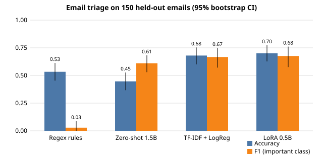

# Model Lab

[](https://github.com/aidankaras/model-lab/actions/workflows/ci.yml)
[](LICENSE)
[](pyproject.toml)

Small, cheap, honest evaluations of which model is worth its price for a given job, run on real workloads instead of leaderboards.

**TL;DR**
- On a real email-triage task, a LoRA-tuned 0.5B model reached **70% accuracy** (95% CI 63-77%) against **53%** for the production regex rules. But a TF-IDF + logistic regression baseline that trains in 1.5 seconds got **68%**, and the difference between the two is not statistically significant (McNemar p = 0.70). With 263 training emails, the classic baseline is the better engineering choice: about 90x faster per email and no deep-learning dependencies.
- Across the model-comparison experiments, the ranking of models often depended on **which grader** scored them. Single-grader "A beats B" claims are treated as indicative only.
- Paying for higher reasoning effort bought no clear quality gain on these tasks; the cheapest model had the lowest cost per passed task.



## Problem

Benchmarks measure the wrong thing for a personal assistant stack: a model can top a leaderboard and still be verbose enough to double output cost, weak at tool use, or prone to confident falsehoods. The question here is narrower: **which model gives the best value for each job, measured on tasks like the ones actually run?**

## Method

- **Cost per passed task.** Each task is pass/fail; the headline number is total spend divided by tasks passed (`modellab/scoring.py`). Zero passes means the number is undefined, not zero.
- **Cross-family graders.** The grader is never the candidate and never from the candidate's family (`grader_conflicts` / `assert_grader_separate`). Where this was violated in an early run, the write-up flags the affected cells as contaminated.
- **Fabrication = automatic fail.** A task passes only if the grader passes it and there are zero fabricated claims.
- **Grader robustness.** After finding that rankings moved with the grader, the bar became a majority of three graders from different model families.
- **Uncertainty is reported.** Email-triage metrics carry 95% percentile bootstrap intervals (2000 resamples over emails), and paired comparisons use an exact McNemar test (`email_triage/metrics.py`).
- Every experiment states an expected cost before running; total spend across everything in `results/` is a few dollars.

## Email triage: classic baseline vs small LLMs vs rules

Binary "needs attention / skip" on 150 held-out real emails, hand-labeled by the author (71 important / 79 not). The split is by time: systems train on the 263 older emails and are tested on the 150 newest. Data is not released for privacy. Everything ran on a CPU laptop, $0 in API spend.

| System | Acc (95% CI) | Precision | Recall | F1 (95% CI) | p50 / p95 latency | Train time |
|---|---|---|---|---|---|---|
| Production regex rules | .533 (.453-.613) | 1.000 | .014 | .028 (.000-.088) | n/a | n/a |
| Zero-shot Qwen2.5-1.5B-Instruct | .447 (.367-.527) | .458 | .915 | .610 (.530-.682) | 1561 / 2076 ms | none |
| TF-IDF + logistic regression | .680 (.600-.753) | .658 | .676 | .667 (.571-.748) | 1 / 7 ms | 1.5 s |
| LoRA-tuned Qwen2.5-0.5B | .700 (.627-.773) | .691 | .662 | .676 (.576-.761) | 92 / 138 ms | 283 s |

Paired McNemar tests against the LoRA model: rules p = 0.003, zero-shot p < 0.001, TF-IDF p = 0.70.

What this says:
- The rules catch 1 of 71 important emails. As a filter they are close to useless.
- The zero-shot model gets high recall only by calling nearly everything important (77 false positives, 2 true negatives), so its accuracy falls below the 52.7% majority-class rate.
- LoRA and TF-IDF are statistically tied. The fine-tune does not earn its cost at this data size; more labeled data is the lever, not a bigger model.
- The numbers above were reproduced end to end from a clean checkout of these scripts (`email_triage/baseline.py`, `email_triage/triage_binary.py`, `email_triage/make_results.py`) on the private data. Source: [`results/email-triage/lora-triage.json`](results/email-triage/lora-triage.json).

## Model-comparison experiments

| Experiment | Finding | Source |
|---|---|---|
| Reasoning effort ladder (72 runs, 3 models) | No effort level buys a clear quality win. Cost per passed task: kimi-k2.6 $0.0129, deepseek-v4.1-flash $0.0015, glm-5.3-flash $0.0009 (0 fabrications). | [`e08b-effort-ladder.json`](results/e08b-effort-ladder.json) |
| Grader robustness (5 graders, same answers) | Grader spread was 6-9 of 12 points on most cells; a model's apparent lead depended on which grader was used. glm had the lowest spread (2-4). | [`grader-robustness.json`](results/grader-robustness.json) |
| Router test (12 goals, 3 models) | gpt-6-luna 12/12, glm-5.3-flash 12/12, deepseek-v4-flash 11/12. One rater, one batch each. | [`e06-full.json`](results/e06-full.json) |
| Session-mined benchmark (10 tasks, no tools) | glm 10/10, deepseek 10/10, kimi 7/10 (three fabricated-adjacent answers). Tests honesty, not capability. | [`e01b-session-benchmark.json`](results/e01b-session-benchmark.json) |
| Prompt caching, long sessions | Caching works on glm-5.3-flash but saves only 21-36% of input cost because input is already cheap; cached vs fresh input price ratio is 1.56x on glm vs 6.7x on deepseek. | [`e07-prompt-cache.json`](results/e07-prompt-cache.json) |
| Bot-wall browsing test | Negative: neither tool got past a Cloudflare-protected page with defaults. | [`t02-bot-wall.json`](results/t02-bot-wall.json) |

Every result file is described in [`results/README.md`](results/README.md), including what the model names refer to.

## How to reproduce

```bash
python -m venv .venv && . .venv/bin/activate
pip install -r requirements-dev.txt
python -m pytest -q          # offline, no network, no model downloads
ruff check .
```

Demo on the synthetic fixture (20 fake emails, all `example.com` / `acme.com`):

```bash
python -m email_triage.make_results tests/fixtures/emails_synth.jsonl /tmp/none /tmp/out.json
python -m email_triage.chart results/email-triage/lora-triage.json /tmp/chart.svg
```

To run the email study on your own mailbox: `pip install -r requirements-train.txt`, produce a JSONL in the fixture schema (`tid,name,from,subject,snippet,date,labels,split,gold,prod`) plus a `tid<TAB>0|1` label file for the train rows, then:

```bash
python -m email_triage.baseline DATA.jsonl LABELS.tsv OUT_DIR
python -m email_triage.triage_binary lora DATA.jsonl LABELS.tsv OUT_DIR
python -m email_triage.triage_binary zeroshot DATA.jsonl LABELS.tsv OUT_DIR
python -m email_triage.make_results DATA.jsonl OUT_DIR results.json
```

`email_triage/pull.py` shows one way to fetch message metadata through the Gmail API.

The model-comparison JSONs in `results/` are recorded outputs. Raw transcripts and task prompts are not included, so those experiments are documented, not re-runnable from this repo.

## Limits

- Single labeler for the email gold set, n = 150. The confidence intervals are wide (about ±7 points on accuracy).
- The 263 training labels were produced by an LLM from a written rubric, not by a human. That LLM was never used to grade any system.
- CPU-only training and inference; latencies are for one machine and vary with load.
- Model-comparison experiments use n = 2 runs per cell, small task sets (6-12), and in several cases one rater. They are indicative, not publishable.
- The email data and the raw transcripts behind the other experiments are not released.
- Model names and prices are as recorded at run time and will go stale.

## License

MIT, see [LICENSE](LICENSE).
